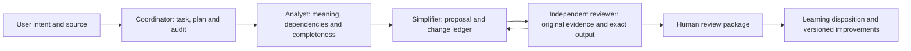

# Architecture and capability boundaries

The host invokes these four roles. Fresh bounded contexts prevent every worker from inheriting the complete conversation. Independent branches may use parallel instances; dependent parts follow a recorded order. Hierarchical synthesis and global review retain source IDs and original evidence.

The Python package supplies local checks and data handling:

| Command | Checks/support | Does not establish |
|---|---|---|
| validate | Unit/output links, transformations, review/approval fields and visual metadata | That all original meaning was captured or preserved |
| quality | Source/task/output file hashes, recorded manifest, obligations/scenarios and impact cards | That a self-declared manifest or semantic judgment is true |
| audit | Immutable copies, chronological hash chain, approach and proposal-closeout gates | Tamper-proof anchoring, real approver authority or automatic host activity capture |
| chunks | Ownership, overlap metadata, dependency waves, declared budgets and merge coverage | Tokenization accuracy, real host capacity or quality of chunk boundaries |
| metrics | Reproducible regex counts and exact input hashes | Workload, comprehension, AI compute, cost or image reduction |
| export-framework | Bundled instructions/templates/schemas/demo | Model installation or automated agent execution |

Existing runtime module APIs remain available for host adapters. The journal is single-writer. Role dispatch, source extraction/OCR, research connectors, semantic inspection, visual editing/rendering, durable concurrent execution and real authority verification belong to the host/integration layer.

Known implementation limits are documented explicitly in each contract. Some metadata checks are intentionally permissive to allow flagged exploratory proposals; they must not be interpreted as adoption approval. Source documents are untrusted data, including commands embedded in images or text.
